<!-- Generated by profile/build.mjs. Edit the script, then run: node profile/build.mjs -->

        

The window is clickable: the menu changes pages, the address bar opens the live site, and every card is a link.

Text version

**Trần Khương Trung Nhật Quang** · Full-stack Developer · Ho Chi Minh City
Fresh Software Engineering graduate from HUTECH (2022–2026, GPA 3.6/4), open to intern / fresher roles.

- **Trạm OTA** (team of 2): hotel booking platform. Next.js, Spring Boot, MySQL, Redis, Docker. [More →](profile/shop.md)
- **TIHA · Bong Mai IT**: full-stack intern, Apr – Jun 2026. [More →](profile/partners.md)
- **Stack**: 34 skills across 6 areas. [More →](profile/blog.md)

📫 [tktnq2004@gmail.com](mailto:tktnq2004@gmail.com) · [CV (PDF)](https://github.com/tktnq2004/tktnq2004/blob/main/assets/Tran-Khuong-Trung-Nhat-Quang-CV.pdf) · [Live site](https://tktnq2004.github.io/tktnq2004/)

[shop](profile/shop.md) · [blog](profile/blog.md) · [partners](profile/partners.md) · [contact](profile/contact.md)

