<!-- Generated by profile/build.mjs. Edit the script, then run: node profile/build.mjs -->

 <a href="https://github.com/tktnq2004"></a><a href="https://tktnq2004.github.io/tktnq2004/blog.html"></a> <a href="https://github.com/tktnq2004"></a><a href="https://github.com/tktnq2004"></a><a href="https://github.com/tktnq2004/tktnq2004/blob/main/profile/shop.md"></a><a href="https://github.com/tktnq2004/tktnq2004/blob/main/profile/blog.md"></a><a href="https://github.com/tktnq2004/tktnq2004/blob/main/profile/partners.md"></a><a href="https://github.com/tktnq2004/tktnq2004/blob/main/profile/contact.md"></a> <a href="https://tktnq2004.github.io/tktnq2004/blog.html"></a> <a href="https://tktnq2004.github.io/tktnq2004/blog.html"></a> <a href="https://github.com/tktnq2004/tktnq2004/blob/main/profile/blog.md"></a> 

The window is clickable: the menu changes pages, the address bar opens the live site, and every card is a link.

Text version

- **Backend:** Spring Boot, Spring Security, Express, Node.js, ASP.NET MVC, JWT auth
- **Frontend:** Next.js, React, Tailwind CSS, Razor Pages, Thymeleaf
- **Databases:** MySQL, SQL Server, MongoDB, Redis
- **Languages:** TypeScript, JavaScript, Java, C#, SQL
- **Integrations:** Stripe, SePay, VNPay, MapLibre GL, Three.js, Pannellum, Cloudflare R2
- **Tools:** Git & GitHub, Docker, Vitest, Jest & Supertest, Vercel, Render, Postman

[home](https://github.com/tktnq2004) · [shop](shop.md) · [partners](partners.md) · [contact](contact.md)

