<!-- Generated by profile/build.mjs. Edit the script, then run: node profile/build.mjs -->

       

The window is clickable: the menu changes pages, the address bar opens the live site, and every card is a link.

Text version

- Email: [tktnq2004@gmail.com](mailto:tktnq2004@gmail.com)
- Phone: 0947 535 906
- GitHub: [@tktnq2004](https://github.com/tktnq2004)
- CV: [PDF](https://github.com/tktnq2004/tktnq2004/blob/main/assets/Tran-Khuong-Trung-Nhat-Quang-CV.pdf)

[home](https://github.com/tktnq2004) · [shop](shop.md) · [blog](blog.md) · [partners](partners.md)

