<!-- Generated by profile/build.mjs. Edit the script, then run: node profile/build.mjs -->

       

The window is clickable: the menu changes pages, the address bar opens the live site, and every card is a link.

Text version

**TIHA · Bong Mai IT**: full-stack intern, Apr – Jun 2026
- Built a management system that moved a lottery agency's ticket sales, agent debts and revenue reports off paper.
- 8 management modules, 6 core workflows and 7 reports; React frontend, REST API in Express.
- Designed the 8-table SQL Server database; deployed to Vercel and Render.

**HUTECH**: Bachelor of Software Engineering, 2022 – 2026, GPA 3.6 / 4

[home](https://github.com/tktnq2004) · [shop](shop.md) · [blog](blog.md) · [contact](contact.md)

