<!-- Generated by profile/build.mjs. Edit the script, then run: node profile/build.mjs -->

 <a href="https://github.com/tktnq2004"></a><a href="https://tktnq2004.github.io/tktnq2004/shop.html"></a> <a href="https://github.com/tktnq2004"></a><a href="https://github.com/tktnq2004/tktnq2004/blob/main/profile/shop.md"></a><a href="https://github.com/tktnq2004/tktnq2004/blob/main/profile/blog.md"></a><a href="https://github.com/tktnq2004/tktnq2004/blob/main/profile/partners.md"></a> <a href="https://tktnq2004.github.io/tktnq2004/shop.html"></a> <a href="https://tktnq2004.github.io/tktnq2004/shop-tram-ota.html"></a> <a href="https://github.com/tktnq2004/Mini-OTA-Upgrade"></a><a href="https://tktnq2004.github.io/tktnq2004/shop-tram-ota.html"></a> <a href="https://github.com/tktnq2004?tab=repositories"></a><a href="https://github.com/tktnq2004?tab=repositories"></a> <a href="https://github.com/tktnq2004/tktnq2004/blob/main/profile/shop.md"></a> 

The window is clickable: the menu changes pages, the address bar opens the live site, and every card is a link.

Text version

### Trạm OTA · team project (2 developers) · Jun 2026 – now
Hotel booking platform for Vietnam. Next.js 16, React 19, TypeScript, Spring Boot 4, MySQL, Redis, Docker, Cloudflare R2, Stripe, SePay.
My part: 60 of 72 frontend commits, 27 of 101 backend commits.
- The booking flow from search to payment, in Vietnamese and English, light and dark.
- Map search, hotel and room pages, account and wishlist.
- The 360° tour editor and the admin and partner back offices.
- Backend: SePay payments, the partner module, admin vs owner/staff permissions, panorama uploads to Cloudflare R2, login by one-time code.

Problems I worked through:
- Deleting a panorama that other rooms link to returns 409 with those hotspots, so a tour never ends up with broken links.
- One login sends each account to /admin or /partner from the hotel it belongs to.
- Tokens stay in httpOnly cookies behind Next.js route handlers; the browser never calls the API directly.
- Guest booking with a one-time code: frontend done, backend still in progress.

[Backend repo](https://github.com/tktnq2004/Mini-OTA-Upgrade) · [Product page](https://tktnq2004.github.io/tktnq2004/shop-tram-ota.html)

### Earlier builds
- **Hotel Booking Management** (MERN · Mar 2025 – Apr 2026): 27 REST endpoints, 5 models, 11 pages; JWT access and refresh tokens with a rotation queue; 6 Jest + Supertest tests
- **Mini OTA v1** (ASP.NET MVC · Apr – Jun 2025): 16-table database, 100+ hotels; MapLibre map, Pannellum 360° tours, VNPay; Unpaid bookings cancel after 20 minutes

[home](https://github.com/tktnq2004) · [blog](blog.md) · [partners](partners.md) · [contact](contact.md)

